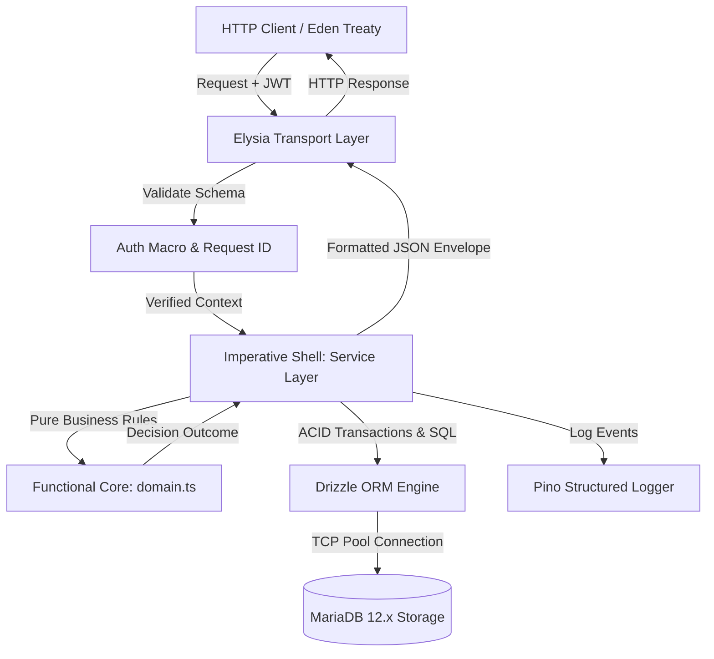
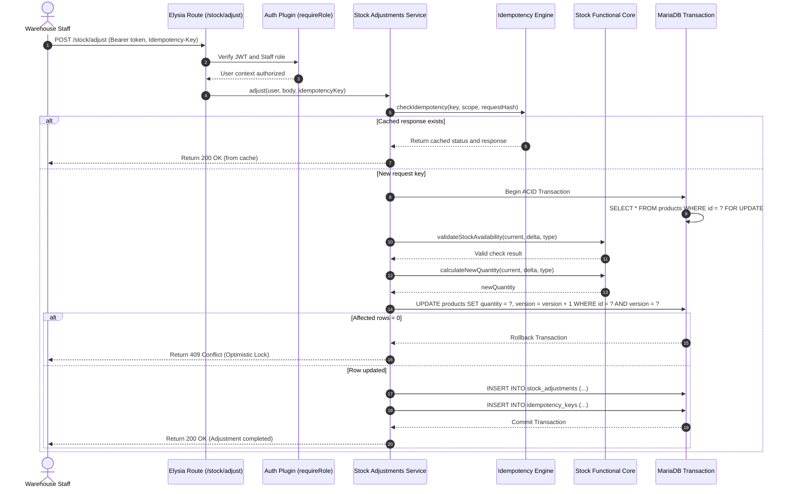

# Architecture Specification: Inventory Stock Tracker API

<!-- @gov:ARCH-OVERVIEW -->
## 1. High-Level Architectural Overview

The Inventory Stock Tracker API is structured as a Modular Monolith applying the Functional Core, Imperative Shell (FC/IS) pattern. The application isolates HTTP transport concerns, deterministic business calculations, and database transaction lifecycles into dedicated, non-overlapping boundaries.



---

<!-- @gov:ARCH-TOPOLOGY -->
## 2. Physical Directory Topology

```text
src/
├── config/
│   └── logger.ts            # High-performance Pino logger with level masking
├── db/
│   ├── index.ts             # Connection pool and Drizzle client instantiation
│   ├── migrate.ts           # Migration execution runner script
│   ├── seed.ts              # Idempotent database seeder script
│   ├── migrations/          # Versioned SQL migration files and metadata
│   └── schema/              # Drizzle table schemas
│       ├── categories.ts    # Categories table definition
│       ├── idempotency-keys.ts # Idempotency cache table
│       ├── index.ts         # Schema aggregator export
│       ├── products.ts      # Products table definition with version column
│       ├── refresh-tokens.ts # Refresh tokens table definition
│       ├── stock-adjustments.ts # Stock movement audit table
│       ├── suppliers.ts     # Suppliers table definition
│       └── users.ts         # Users table definition
├── modules/
│   ├── auth/                # Authentication subsystem
│   │   ├── domain.ts        # Pure token expiration and role checking
│   │   ├── index.ts         # Elysia route registration
│   │   ├── model.ts         # TypeBox request and response DTO schemas
│   │   └── service.ts       # Argon2id password verification and session issuance
│   ├── categories/          # Category catalog subsystem
│   │   ├── domain.ts        # Pure category name validation
│   │   ├── index.ts         # Elysia route registration with RBAC guards
│   │   ├── model.ts         # Category TypeBox schemas
│   │   └── service.ts       # Category queries and case-insensitive check
│   ├── health/              # Health probe subsystem
│   │   └── index.ts         # Database ping endpoint (GET /health)
│   ├── products/            # Product catalog subsystem
│   │   ├── domain.ts        # Pure low stock calculations and pagination math
│   │   ├── index.ts         # Product routes and RBAC guards
│   │   ├── model.ts         # Product TypeBox schemas
│   │   └── service.ts       # Product queries, search, and update handling
│   ├── stock-adjustments/   # Stock movement subsystem
│   │   ├── domain.ts        # Pure stock math and availability validation
│   │   ├── index.ts         # Adjustment and history routes
│   │   ├── model.ts         # Adjustment TypeBox schemas
│   │   └── service.ts       # ACID transactions, version increments, idempotency
│   └── suppliers/           # Supplier catalog subsystem
│       ├── domain.ts        # Pure supplier name and contact validation
│       ├── index.ts         # Supplier routes and RBAC guards
│       ├── model.ts         # Supplier TypeBox schemas
│       └── service.ts       # Supplier persistence and delete restriction
├── openapi/
│   └── config.ts            # Swagger OpenAPI plugin configuration
├── shared/
│   ├── errors/              # AppError custom error class
│   ├── middleware/          # Request ID and JWT Auth plugins
│   ├── schemas/             # Standard envelope and pagination schemas
│   └── services/            # Idempotency hashing and check utilities
└── index.ts                 # Application root entry point
```

---

<!-- @gov:ARCH-BINDING -->
## 3. Formal Specification Alignment

All system behavior maps directly to computable architecture contracts and formal requirements:

- **Requirements Grammar (ISO/IEC/IEEE 29148:2018)**: [`docs/PRD.md`](docs/PRD.md)
- **Technical Design Mappings**: [`docs/TDD.md`](docs/TDD.md)
- **Architecture-as-Code Database Schema**: [`docs/schema.dbml`](docs/schema.dbml)
- **Interactive Wire Protocol API Documentation**: Available at runtime via `/openapi`

---

<!-- @gov:ARCH-LIFELINE -->
## 4. Cross-Module Data Flow Lifeline: Stock Adjustment

The following sequence illustrates the end-to-end data flow for an inventory adjustment request:



---

<!-- @gov:ARCH-INVARIANTS -->
## 5. Architectural Boundary Invariants

1. **Domain Purity Invariant**<br>
   No function inside any `domain.ts` file may import from `drizzle-orm`, `elysia`, `mysql2`, or any file containing I/O side effects. Domain functions must remain 100% synchronous and pure.
2. **Optimistic Locking Invariant**<br>
   All stock level mutations must execute an atomic SQL update validating the current in-memory `version` column against the database record (`version = version + 1 WHERE id = ? AND version = ?`).
3. **Idempotency Invariant**<br>
   Stock adjustment mutations require a client-submitted `Idempotency-Key` HTTP header. Replaying the exact same request hash within 24 hours must return the cached response without altering inventory levels.
4. **Referential Integrity Invariant**<br>
   Foreign key relationships between products, categories, suppliers, and stock adjustments enforce `ON DELETE RESTRICT`. Deleting parent entities linked to active records must be rejected with HTTP 409 Conflict.
5. **Traceability Closure Invariant**<br>
   Every functional requirement declared as `MUST` in `docs/PRD.md` must link symmetrically to design documentation, production implementation (`@impl`), and automated tests (`@test`), verified by `asep_check`.
